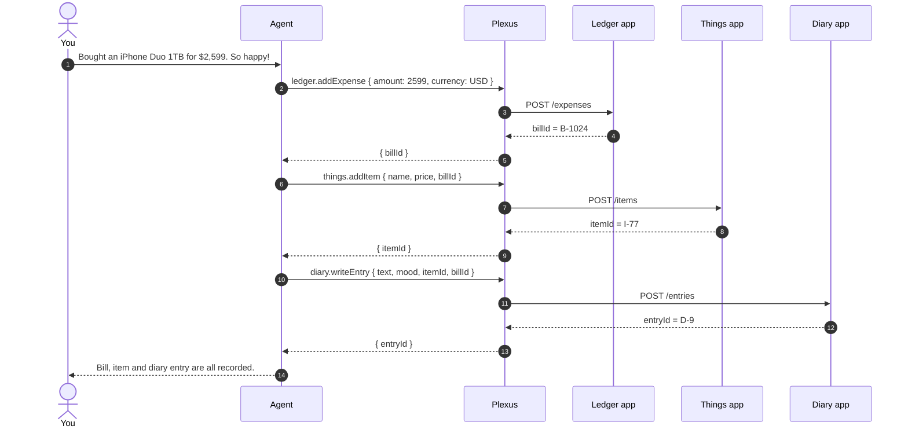

# plexus

**Your APIs, as MCP tools.** A personal MCP gateway — one endpoint, one token, one process.

[](https://github.com/LaiGZ/plexus-dev/actions/workflows/ci.yml)
[](LICENSE)
[](package.json)

**English** · [简体中文](README.zh-CN.md)

Point plexus at an HTTP API, an OpenAPI document, or a remote MCP server. Pick the methods to
expose, and hand one MCP endpoint to Claude, Cursor, VS Code, or any MCP client. One admin, one
SQLite file, one process — no cloud account, no tenant model, no permission screens.

It does not run your agents or host your apps. It sits between them: it owns the tool contracts,
the credentials, and the audit trail.

```
OpenAPI / HTTP / MCP ──▶ App ──▶ Methods ──▶ Tools ──▶ POST /mcp
                        │                              │
                        └── /admin/mcp (manage it)      └── read / write tokens
```

## Why this exists

AI can now write you a small app in an afternoon: a ledger, a shelf for the things you own, a
diary. Each one is useful on its own and useless together. The moment you want to "log this
purchase, add it to my things, and write down how I feel", you are back to opening three apps
and copying ids between them.

plexus gives every app you build the same shape — a few HTTP methods — turns them into MCP tools,
and gives your agent one endpoint. The agent composes them in a single turn:

> “I bought an iPhone Duo 1TB for $2,599 today. So happy!”

| # | Tool | What happens |
|---|---|---|
| 1 | `ledger.addExpense` | Creates the expense, returns `billId` |
| 2 | `things.addItem` | Creates the item and links it to `billId` |
| 3 | `diary.writeEntry` | Writes the entry, links `itemId` + `billId` |



The apps only need to expose a few HTTP methods — plexus handles auth, schema validation, the MCP
layer, idempotency and the log. Writes pause for your approval in the assistant, and every call is
recorded with the caller and result.

> Apps can also call each other directly through `POST /api/gateway/invoke` with an explicit
> grant; the flow above is the agent composing tools, which needs no app-to-app wiring.

## What you get

- **One endpoint for everything.** Aggregate REST APIs, OpenAPI documents and remote MCP servers
  behind a single `/mcp` URL with stable tool names (`finance.createBill`).
- **A real gateway, not a proxy.** Scope checks, JSON Schema validation, rate limiting,
  idempotency, an SSRF guard and an invocation log run on every call.
- **Safe by default.** Exposure is an explicit choice in the wizard, tokens are read-only until
  you create a write token, writes need approval in the assistant, and private networks are
  blocked.
- **An assistant included.** Chat with the same tools; writes pause for an explicit approval.
- **Manageable by machines.** A zero-dependency CLI and a separate admin MCP endpoint so an AI
  agent can create apps, add methods and read logs.

## Concepts

| Term | Meaning |
|---|---|
| **App** | An upstream service you connect: an HTTP endpoint, an OpenAPI document, or a remote MCP server |
| **Method** | One operation on that app (`POST /api/createBill`); imported or added by hand |
| **Tool** | What MCP clients see. Stable name `app.method`, protocol name `app__method` |
| **Token** | `px_…` bearer token for `/mcp`; `read` or `write`, optionally limited to some apps |
| **Grant** | Which apps may call which tools through `POST /api/gateway/invoke` |
| **Admin token** | `ADMIN_MCP_TOKEN`, required to use `/admin/mcp` |

MCP tool names must match `[A-Za-z0-9_-]{1,64}` (Claude/OpenAI reject dots), so the UI shows
`finance.createBill` while the protocol uses `finance__createBill`.

## Quick start

### Docker

```bash
docker build -t plexus .
docker run --rm -p 3000:3000 -v plexus-data:/data plexus
```

Prebuilt multi-arch images are published to GHCR on tagged releases
(`ghcr.io/laigz/plexus-dev`); until then, build locally.

The first boot creates the admin `plexus` with a random password, printed **once**:

```
────────────────────────────────────────────────────────────────
  Initial administrator created

    username: plexus
    password: <generated>
────────────────────────────────────────────────────────────────
```

Open <http://127.0.0.1:3000>, sign in, and change the password in **Settings**.

### From source

```bash
pnpm install
pnpm build
pnpm --filter @plexus/server start
```

For development (API on `:3000`, web on `:5566` with a proxy):

```bash
pnpm dev
```

Set `PLEXUS_ADMIN_PASSWORD` before the first boot for a deterministic password (useful in CI).

### Five-minute demo

```bash
# Terminal 1: a tiny example API
PORT=7100 node examples/mock-api.mjs

# Terminal 2: plexus with the offline stub model
MODEL_PROVIDER=stub pnpm --filter @plexus/server start
```

1. **Apps → Connect app**, name it `Todo`, Base URL `http://127.0.0.1:7100`.
2. **Next → Import from OpenAPI**, paste [`examples/openapi/todo.yaml`](examples/openapi/todo.yaml),
   then **Import methods**. (Or download the YAML template and import that.)
3. **Review** → keep “Expose to the platform” checked → **Create app**.
4. **Settings → Access tokens → Create token** (scope `read`), copy it.
5. **Overview** → pick your client → copy the config, replace `<YOUR_TOKEN>`.

That is the whole loop. `/chat` can drive the same tools; write methods pause for approval.

## Two MCP endpoints

| Endpoint | Auth | Purpose |
|---|---|---|
| `POST /mcp` | `Authorization: Bearer px_…` | Your apps' tools, for AI clients |
| `POST /admin/mcp` | `Authorization: Bearer $ADMIN_MCP_TOKEN` | Manage the instance (apps, methods, grants, tokens, logs) |

`/admin/mcp` is **disabled** unless `ADMIN_MCP_TOKEN` is set. Destructive admin tools
(`delete_tool`, `import_app`) only act with `confirm: true`; without it they return the impact
first. See [docs/en/ADMIN_MCP.md](docs/en/ADMIN_MCP.md).

## For AI and automation

```bash
# zero-dependency CLI
node scripts/plexus.mjs apps list
node scripts/plexus.mjs apps create --file my-app.yaml
node scripts/plexus.mjs tools add finance --name createBill --method POST \
  --path /api/createBill --write --expose
node scripts/plexus.mjs grants set Project --tools finance.createBill
node scripts/plexus.mjs invoke finance.createBill --args '{"amount":42}'
```

- `--json` for machine-readable output
- destructive commands print their impact and exit `2` until you add `--yes`
- `apps export` / `apps import` move an app's configuration with a previewed diff
- annotated YAML templates: **Connect app → Download template** (the platform generates `app_id`)

Full reference: [docs/en/CLI.md](docs/en/CLI.md).

## Features

| Area | State |
|---|---|
| Single admin, `super_admin` role, random password on first boot | ✅ |
| Cookie sessions, CSRF header, login rate limit, password rotation | ✅ |
| SQLite + automatic migrations on boot | ✅ |
| Apps from OpenAPI 3.x / Swagger 2.x (internal `$ref` only) or a single HTTP endpoint | ✅ |
| Remote MCP servers as an app kind (discover tools, proxy calls) | ✅ |
| Per-method exposure, enable/disable, side effect, editable schema | ✅ |
| Gateway: scope, rate limit, JSON Schema validation, idempotency, invocation log | ✅ |
| SSRF guard: one DNS lookup, pinned IP, no redirects, private ranges blocked | ✅ |
| MCP over Streamable HTTP (official SDK), read/write tokens scoped to apps | ✅ |
| App credentials (`app_id` + secret) and `POST /api/gateway/invoke` for backends | ✅ |
| App-to-app grants: an app can only call the tools you allow | ✅ |
| App config export/import with a diff and `app_id` check | ✅ |
| Annotated YAML templates for creating apps | ✅ |
| Invocation log with caller attribution and filters | ✅ |
| Built-in assistant: conversations, streaming Markdown, write approvals, configurable model | ✅ |
| Bilingual UI (English / 中文) | ✅ |
| Zero-dependency CLI and an admin MCP endpoint | ✅ |

## Configuration

A `.env` in the working directory or `apps/server/` is loaded automatically. Invalid values
abort startup with a readable list.

| Variable | Default | Notes |
|---|---|---|
| `HOST` | `127.0.0.1` | Keep loopback unless a reverse proxy fronts it |
| `PORT` | `3000` | |
| `PUBLIC_URL` | `http://HOST:PORT` | Used in copy-paste client configs |
| `DATA_DIR` | `./data` | SQLite database + generated key material |
| `DATABASE_FILE` | `plexus.db` | Relative to `DATA_DIR`, or `:memory:` |
| `PLEXUS_ADMIN_USERNAME` | `plexus` | Created on first boot only |
| `PLEXUS_ADMIN_PASSWORD` | _random_ | If unset, generated and printed once |
| `SESSION_TTL_HOURS` | `168` | Session cookie lifetime |
| `COOKIE_SECURE` | `false` | Set `true` behind HTTPS |
| `TRUST_PROXY` | `false` | Trust `X-Forwarded-For` |
| `LOG_LEVEL` | `info` | `fatal` … `trace`, or `silent` |
| `UPSTREAM_TIMEOUT_MS` | `15000` | Gateway → upstream timeout |
| `EGRESS_ALLOW_HOSTS` | `127.0.0.1,localhost` | Hosts allowed to resolve to private IPs |
| `RATE_LIMIT_PER_SEC` | `20` | Per token and tool |
| `INVOCATION_RETENTION_DAYS` | `90` | Log retention |
| `MODEL_PROVIDER` | `deepseek` | `deepseek`, `openai`, or `stub`; also in **Settings → Model** |
| `MODEL_API_KEY` | — | Fallback when no key is saved in Settings |
| `MODEL_BASE_URL` | provider default | Any OpenAI-compatible endpoint |
| `MODEL_NAME` | provider default | |
| `MODEL_TIMEOUT_MS` | `120000` | |
| `AGENT_MAX_STEPS` | `6` | Tool-loop ceiling |
| `ADMIN_MCP_TOKEN` | — | Enables `POST /admin/mcp`; unset = disabled |

## Security model

- **One owner.** Whoever holds the password controls the instance. Change the generated one.
- **Exposure is explicit.** The wizard asks whether to expose the methods it creates, and every
  method can be turned off individually. `read` tokens cannot see write tools; writes in the
  assistant require an approval click.
- **Egress policy.** DNS is resolved once and the socket is pinned to that IP (no rebinding),
  redirects are refused, and private/link-local ranges are blocked unless allow-listed.
- **Secrets at rest.** App credentials use AES-256-GCM under `DATA_DIR/.secret`; MCP tokens are
  stored as SHA-256 hashes; model keys are encrypted and never returned.
- **Admin surface is opt-in.** `/admin/mcp` is off without a long token; destructive tools are
  preview-first.
- **No telemetry.** The only outbound calls are the ones you configure.

Exposing it publicly? Put HTTPS in front, set `COOKIE_SECURE=true`, and read
[docs/SECURITY.md](SECURITY.md).

## Documentation

- [docs/en/ARCHITECTURE.md](docs/en/ARCHITECTURE.md) — design decisions and module map
- [docs/en/APPS.md](docs/en/APPS.md) — connect apps, templates, import/export, grants
- [docs/en/CLIENTS.md](docs/en/CLIENTS.md) — Claude, Cursor, VS Code, curl, stdio bridge
- [docs/en/ADMIN_MCP.md](docs/en/ADMIN_MCP.md) — manage the instance over MCP
- [docs/en/CLI.md](docs/en/CLI.md) — command line for people and AI agents
- [docs/en/TROUBLESHOOTING.md](docs/en/TROUBLESHOOTING.md) — error codes and fixes

## Development

```bash
pnpm install
pnpm dev           # contracts build + server + web
pnpm typecheck
pnpm test
pnpm lint
pnpm build
node scripts/smoke.mjs   # end-to-end against a running instance
```

The schema lives in `apps/server/src/infra/db/schema.ts`; run `pnpm db:generate` and the
migration applies on the next boot. Tests include contract tests with the real MCP client and an
end-to-end smoke script.

See [CONTRIBUTING.md](CONTRIBUTING.md) before opening a PR.

## Roadmap

- Read-only admin tokens (manage nothing destructive, still inspect apps and logs)
- Per-tool token scopes (today: read/write per token, optionally per app)
- OAuth 2.1 for MCP and SSE transport in addition to Streamable HTTP
- More importers (cURL, Postman, GraphQL)
- Optional Postgres backing for people who want it

## License

[Apache-2.0](LICENSE)
