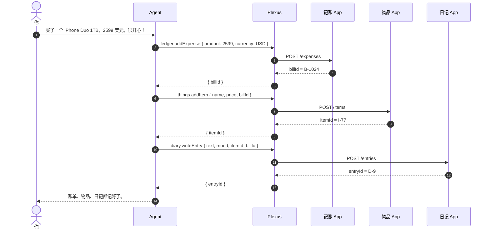

# plexus

**把你的 API 变成 MCP 工具。** 个人版 MCP 网关 —— 一个端点、一个令牌、一个进程。

[](https://github.com/LaiGZ/plexus-dev/actions/workflows/ci.yml)
[](LICENSE)
[](package.json)

[English](README.md) · **简体中文**

把 plexus 指向一个 HTTP API、一份 OpenAPI 文档，或一个远程 MCP 服务器，勾选要开放的方法，
然后把一个 MCP 端点交给 Claude、Cursor、VS Code 或任意 MCP 客户端。一个管理员、一个 SQLite
文件、一个进程 —— 不需要云账号、没有租户模型、没有权限配置页。

plexus 不运行你的 agent，也不托管你的应用。它站在两者之间：管住工具契约、凭据和调用记录。

```
OpenAPI / HTTP / MCP ──▶ 应用 ──▶ 方法 ──▶ 工具 ──▶ POST /mcp
                        │                            │
                        └── /admin/mcp（管理它）       └── 只读 / 写入令牌
```

## 为什么做这个

AI 现在一个下午就能给你写一个小应用：一个记账本、一个物品清单、一个日记。每个单独用都不错，
放在一起却用不起来。当你想要「记一笔账、把东西加进物品库、再写今天的日记」时，又得打开三个
应用，在它们之间复制 id。

plexus 让每个应用都长成同一种形状 —— 几个 HTTP 方法 —— 把它们变成 MCP 工具，再给你的 agent
一个端点。于是 agent 可以在一轮对话里把它们串起来：

> 「我今天买了一个 iPhone Duo 1TB，花了 2599 美元，很开心！」

| # | 工具 | 发生了什么 |
|---|---|---|
| 1 | `ledger.addExpense` | 新增账单，返回 `billId` |
| 2 | `things.addItem` | 新增物品，并关联 `billId` |
| 3 | `diary.writeEntry` | 写日记，关联 `itemId` + `billId` |



这些应用只需要暴露几个 HTTP 方法 —— 鉴权、Schema 校验、MCP 层、幂等和日志都由 plexus 负责。
助手里的写操作会先等你确认，每次调用都会记录调用方和结果。

> 应用之间也可以通过 `POST /api/gateway/invoke` 加显式授权互相调用；上面这条链路是 agent 自己
> 编排工具，不需要任何应用间接线。

## 你能得到什么

- **一个端点装下所有能力。** 把 REST API、OpenAPI 文档和远程 MCP 服务器聚合成一个 `/mcp`
  地址，工具名保持稳定（`finance.createBill`）。
- **真正的网关，不只是代理。** 每次调用都会经过 scope 校验、JSON Schema 校验、限流、幂等、
  SSRF 防护和审计日志。
- **默认安全。** 是否暴露由你在向导里明确选择；令牌默认只读，写入需要单独创建 write 令牌；
  助手执行写操作必须人工确认；私网地址默认拦截。
- **自带助手。** 用同一批工具对话，写操作会挂起等待你点「同意」。
- **可被机器管理。** 零依赖 CLI + 独立的管理 MCP 端点，AI agent 可以直接创建应用、添加方法、
  查看日志。

## 概念

| 术语 | 含义 |
|---|---|
| **应用（App）** | 你接入的上游服务：一个 HTTP 端点、一份 OpenAPI 文档，或一个远程 MCP 服务器 |
| **方法（Method）** | 应用上的一个操作（`POST /api/createBill`），可以导入或手写 |
| **工具（Tool）** | MCP 客户端看到的东西。展示名 `app.method`，协议名 `app__method` |
| **令牌（Token）** | 给 `/mcp` 用的 `px_…` Bearer 令牌；`read` 或 `write`，可限制到指定应用 |
| **授权（Grant）** | 哪个应用可以通过 `POST /api/gateway/invoke` 调哪些工具 |
| **管理令牌** | `ADMIN_MCP_TOKEN`，使用 `/admin/mcp` 必须提供 |

MCP 工具名必须匹配 `[A-Za-z0-9_-]{1,64}`（Claude/OpenAI 不接受点号），所以界面显示
`finance.createBill`，协议里用 `finance__createBill`。

## 快速开始

### Docker

```bash
docker build -t plexus .
docker run --rm -p 3000:3000 -v plexus-data:/data plexus
```

打 tag 发版时会推送多架构镜像到 GHCR（`ghcr.io/laigz/plexus-dev`）；在那之前请本地构建。

首次启动会创建管理员 `plexus`，并**只打印一次**随机密码：

```
────────────────────────────────────────────────────────────────
  Initial administrator created

    username: plexus
    password: <随机生成>
────────────────────────────────────────────────────────────────
```

打开 <http://127.0.0.1:3000> 登录，然后到**设置**里改密码。

### 从源码运行

```bash
pnpm install
pnpm build
pnpm --filter @plexus/server start
```

开发模式（API `:3000`，前端 `:5566` 并带代理）：

```bash
pnpm dev
```

如果希望首次启动使用固定密码（CI 很方便），提前设置 `PLEXUS_ADMIN_PASSWORD`。

### 五分钟演示

```bash
# 终端 1：一个很小的示例 API
PORT=7100 node examples/mock-api.mjs

# 终端 2：用离线 stub 模型启动 plexus
MODEL_PROVIDER=stub pnpm --filter @plexus/server start
```

1. **应用 → 接入应用**，名称填 `Todo`，Base URL 填 `http://127.0.0.1:7100`。
2. **下一步 → 从 OpenAPI 导入**，粘贴
   [`examples/openapi/todo.yaml`](examples/openapi/todo.yaml)，点**导入方法**。
   （也可以下载 YAML 模板再导入。）
3. **确认** → 保持勾选「创建后开放给平台」→ **创建应用**。
4. **设置 → 访问令牌 → 创建令牌**（scope 选 `read`），复制。
5. **概览** → 选择你的客户端 → 复制配置，把 `<YOUR_TOKEN>` 换成刚复制的令牌。

这就是完整闭环。`/chat` 里的助手也能用同一批工具；写方法会先征求你的确认。

## 两个 MCP 端点

| 端点 | 鉴权 | 用途 |
|---|---|---|
| `POST /mcp` | `Authorization: Bearer px_…` | 你接入的应用的工具，给 AI 客户端用 |
| `POST /admin/mcp` | `Authorization: Bearer $ADMIN_MCP_TOKEN` | 管理实例（应用、方法、授权、令牌、日志） |

未设置 `ADMIN_MCP_TOKEN` 时 `/admin/mcp` 是**关闭**的。危险的管理工具（`delete_tool`、
`import_app`）只有带 `confirm: true` 才执行；不带时只返回影响预览。详见
[docs/zh/ADMIN_MCP.md](docs/zh/ADMIN_MCP.md)。

## 面向 AI 与自动化

```bash
# 零依赖 CLI
node scripts/plexus.mjs apps list
node scripts/plexus.mjs apps create --file my-app.yaml
node scripts/plexus.mjs tools add finance --name createBill --method POST \
  --path /api/createBill --write --expose
node scripts/plexus.mjs grants set Project --tools finance.createBill
node scripts/plexus.mjs invoke finance.createBill --args '{"amount":42}'
```

- `--json` 输出机器可读结果
- 危险命令默认只打印影响并以退出码 `2` 结束，加 `--yes` 才执行
- `apps export` / `apps import` 用于迁移应用配置，导入前会先给出 diff
- 带注释的 YAML 模板：**接入应用 → 下载模板**（`app_id` 由平台生成）

完整命令见 [docs/zh/CLI.md](docs/zh/CLI.md)。

## 功能

| 能力 | 状态 |
|---|---|
| 单管理员、`super_admin` 角色、首次启动随机密码 | ✅ |
| Cookie 会话、CSRF 头、登录限流、改密 | ✅ |
| SQLite + 启动时自动迁移 | ✅ |
| 从 OpenAPI 3.x / Swagger 2.x 导入应用（仅内部 `$ref`）或单个 HTTP 端点 | ✅ |
| 远程 MCP 服务器作为应用类型（发现工具、代理调用） | ✅ |
| 方法级暴露、启用/禁用、副作用、可编辑 Schema | ✅ |
| 网关：scope、限流、JSON Schema 校验、幂等、调用日志 | ✅ |
| SSRF 防护：只解析一次 DNS、固定 IP、不跟随重定向、拦截私网 | ✅ |
| 基于官方 SDK 的 Streamable HTTP MCP，读写令牌可按应用限制 | ✅ |
| 应用凭据（`app_id` + secret）与 `POST /api/gateway/invoke` | ✅ |
| 应用间授权：只能调用你允许的工具 | ✅ |
| 应用配置导出/导入（带 diff 与 `app_id` 校验） | ✅ |
| 带注释的 YAML 应用模板 | ✅ |
| 调用日志，含调用方归属与筛选 | ✅ |
| 内置助手：多会话、流式 Markdown、写操作确认、模型可配置 | ✅ |
| 中英双语界面 | ✅ |
| 零依赖 CLI 与管理 MCP 端点 | ✅ |

## 配置

工作目录或 `apps/server/` 下的 `.env` 会被自动加载。配置不合法会在启动时直接失败，并列出
具体字段。

| 变量 | 默认值 | 说明 |
|---|---|---|
| `HOST` | `127.0.0.1` | 除非前面有反向代理，否则保持回环地址 |
| `PORT` | `3000` | |
| `PUBLIC_URL` | `http://HOST:PORT` | 用于生成可复制的客户端配置 |
| `DATA_DIR` | `./data` | SQLite 数据库与自动生成的密钥 |
| `DATABASE_FILE` | `plexus.db` | 相对 `DATA_DIR`，或 `:memory:` |
| `PLEXUS_ADMIN_USERNAME` | `plexus` | 只在首次启动时创建 |
| `PLEXUS_ADMIN_PASSWORD` | _随机_ | 不设置则生成并只打印一次 |
| `SESSION_TTL_HOURS` | `168` | 会话有效期 |
| `COOKIE_SECURE` | `false` | 走 HTTPS 时设为 `true` |
| `TRUST_PROXY` | `false` | 是否信任 `X-Forwarded-For` |
| `LOG_LEVEL` | `info` | `fatal` … `trace`，或 `silent` |
| `UPSTREAM_TIMEOUT_MS` | `15000` | 网关调用上游的超时 |
| `EGRESS_ALLOW_HOSTS` | `127.0.0.1,localhost` | 允许解析到私网的主机 |
| `RATE_LIMIT_PER_SEC` | `20` | 每个令牌 × 工具 |
| `INVOCATION_RETENTION_DAYS` | `90` | 日志保留天数 |
| `MODEL_PROVIDER` | `deepseek` | `deepseek`、`openai` 或 `stub`；也可在**设置 → 模型**里改 |
| `MODEL_API_KEY` | — | 设置页未保存密钥时的回退值 |
| `MODEL_BASE_URL` | 服务商默认 | 任意 OpenAI 兼容端点 |
| `MODEL_NAME` | 服务商默认 | |
| `MODEL_TIMEOUT_MS` | `120000` | |
| `AGENT_MAX_STEPS` | `6` | 单轮工具循环上限 |
| `ADMIN_MCP_TOKEN` | — | 启用 `POST /admin/mcp`；不设置即关闭 |

## 安全模型

- **只有一个所有者。** 拿到密码的人控制整个实例，请务必改掉初始密码。
- **暴露是显式选择。** 向导会询问是否开放它创建的方法，之后每个方法也能单独关闭。`read`
  令牌看不到写工具；助手里的写操作需要点「同意」。
- **出网策略。** DNS 只解析一次并把 socket 固定到该 IP（防重绑定），拒绝跟随重定向；私网与
  链路本地地址默认拦截，除非显式加白名单。
- **静态加密。** 应用凭据使用 `DATA_DIR/.secret` 下的 AES-256-GCM 加密；MCP 令牌只存
  SHA-256；模型密钥加密保存且永不回显。
- **管理面默认关闭。** 没有长令牌时 `/admin/mcp` 不可用；危险工具默认只预览。
- **无遥测。** 只有你配置过的出网请求会发生。

要暴露到公网？在前面加 HTTPS，设置 `COOKIE_SECURE=true`，并阅读
[docs/SECURITY.md](SECURITY.md)。

## 文档

- [docs/zh/ARCHITECTURE.md](docs/zh/ARCHITECTURE.md) — 设计决策与模块结构
- [docs/zh/APPS.md](docs/zh/APPS.md) — 接入应用、模板、导入导出、授权
- [docs/zh/CLIENTS.md](docs/zh/CLIENTS.md) — Claude、Cursor、VS Code、curl、stdio 桥接
- [docs/zh/ADMIN_MCP.md](docs/zh/ADMIN_MCP.md) — 通过 MCP 管理实例
- [docs/zh/CLI.md](docs/zh/CLI.md) — 给人或 AI agent 用的命令行
- [docs/zh/TROUBLESHOOTING.md](docs/zh/TROUBLESHOOTING.md) — 错误码与排查

> 文档提供中英两版，每篇顶部都有语言切换。

## 开发

```bash
pnpm install
pnpm dev           # 构建 contracts + 启动 server / web
pnpm typecheck
pnpm test
pnpm lint
pnpm build
node scripts/smoke.mjs   # 针对运行中的实例做端到端验证
```

数据模型在 `apps/server/src/infra/db/schema.ts`；改完执行 `pnpm db:generate`，迁移会在下次
启动时自动应用。测试包含真实 MCP 客户端的契约测试和端到端 smoke。

提 PR 前请阅读 [CONTRIBUTING.md](CONTRIBUTING.md)。

## 路线图

- 只读管理令牌（不能改东西，但能查看应用与日志）
- 按工具粒度的令牌 scope（目前是 read/write，可按应用限制）
- MCP 的 OAuth 2.1 与 SSE 传输
- 更多导入方式（cURL、Postman、GraphQL）
- 可选的 Postgres 支持

## 许可证

[Apache-2.0](LICENSE)
